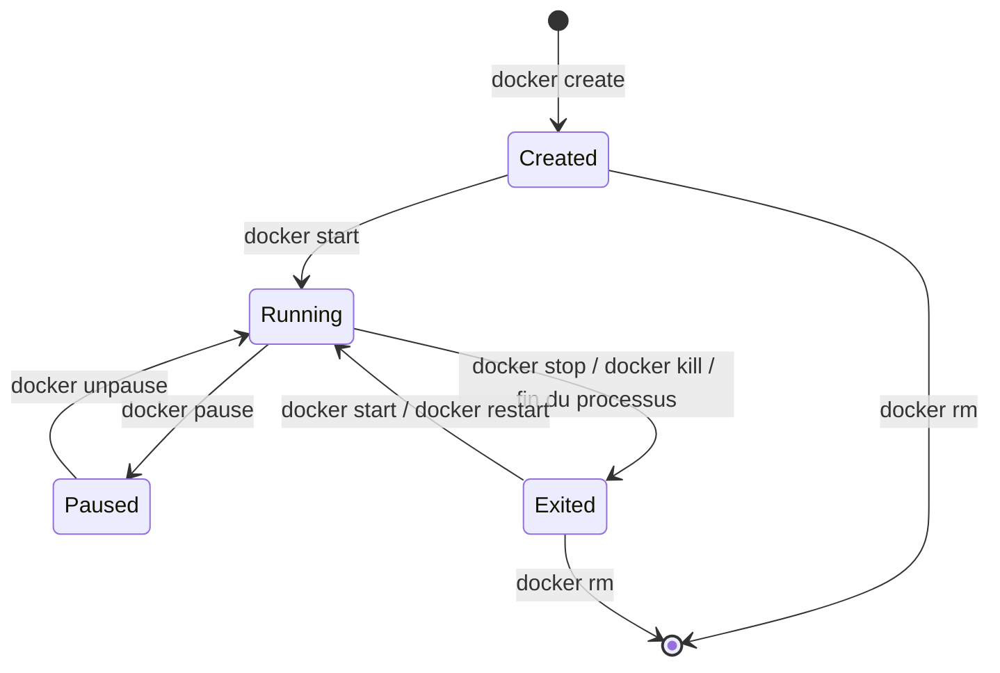



# Contexte

Votre installation fonctionne et vous savez lancer un conteneur. Avant d'écrire vos propres images, il faut savoir exploiter celles des autres : les démarrer avec la bonne configuration, comprendre dans quel état elles se trouvent, lire ce qu'elles racontent et les empêcher de consommer toutes les ressources de la machine.

Ce TP n'utilise aucun `Dockerfile`. Le fil rouge est l'image officielle `nginx`, un serveur web dont chaque paramètre (port, fichiers servis, configuration, logs) se vérifie immédiatement dans un navigateur ou avec `curl`. Les tests de limites utilisent `alpine`.

> Les commandes sont écrites pour un shell bash ou zsh (Linux, macOS, WSL). Sous PowerShell, remplacez `$PWD` par `${PWD}` et `curl` par `curl.exe`.

---

## Objectifs

<div class="section objective">

1. Lire le contenu et les métadonnées d'une image sans la lancer
2. Faire passer un conteneur par tous les états de son cycle de vie
3. Publier un port, monter un dossier ou un volume, injecter des variables d'environnement
4. Lire les logs d'un conteneur et exécuter des commandes à l'intérieur
5. Observer la consommation d'un conteneur et lui imposer des limites de mémoire et de CPU

</div>

---

## Étape 1 - Anatomie d'une image

Une image n'est pas qu'un système de fichiers : elle contient aussi des **métadonnées** qui décrivent comment la lancer (commande par défaut, ports, variables d'environnement, signal d'arrêt).

**Ce que vous devez faire :**

- Téléchargez l'image `nginx:stable-alpine`, puis listez vos images locales.
- Affichez l'historique de l'image : les couches qui la composent et l'instruction qui a produit chacune d'elles.
- Inspectez l'image et relevez : la commande par défaut (`Cmd`), le point d'entrée (`Entrypoint`), les ports déclarés (`ExposedPorts`), les variables d'environnement (`Env`).

**Questions de réflexion :**

- Certaines lignes de l'historique ont une taille de `0B`. Qu'est-ce que cela signifie ?

{::nomarkdown}
<details><summary>Solution - Étape 1</summary>
{:/nomarkdown}

```bash
docker pull nginx:stable-alpine
docker image ls
docker history nginx:stable-alpine (--no-trunc)
docker image inspect nginx:stable-alpine
```

`docker image inspect` renvoie un long document JSON. L'option `--format` (ou `-f`) extrait les champs utiles avec la syntaxe des templates Go :

```bash
docker image inspect -f '{{.Config.Entrypoint}} {{.Config.Cmd}}' nginx:stable-alpine
docker image inspect -f '{{json .Config.ExposedPorts}}' nginx:stable-alpine
docker image inspect -f '{{json .Config.Env}}' nginx:stable-alpine
docker image inspect -f '{{.Config.StopSignal}}' nginx:stable-alpine
```

Les lignes à `0B` de `docker history` correspondent à des instructions qui ne modifient que les métadonnées (`CMD`, `EXPOSE`, `ENV`, `STOPSIGNAL`...) et ne créent donc pas de fichiers.

{::nomarkdown}
</details>
{:/nomarkdown}

---

## Étape 2 - Le cycle de vie d'un conteneur

Un conteneur passe par plusieurs états, et chaque commande de la CLI le fait passer de l'un à l'autre :



`docker run` n'est qu'un raccourci pour `docker create` suivi de `docker start`.

**Ce que vous devez faire :**

- Créez un conteneur nommé `cycle` à partir de `nginx:stable-alpine` **sans le démarrer**. Vérifiez son état avec `docker ps -a`.
- Démarrez-le, vérifiez que le container tourne. 
- Executez des commandes dans le container, par exemple `ps -ef` pour lister les process, et affichez le script d'entrypoint de l'image.
- Puis mettez-le en pause/unpause. Essayez d'exécuter les commandes dedans. Affichez le status
- Arrêtez proprement le container et relevez son code de sortie avec `inspect`.
- Redémarrez-le, puis arrêtez-le cette fois avec docker `kill`. Relevez le nouveau code de sortie.
- Essayez de supprimer `cycle` alors qu'il tourne, puis supprimez-le.

- Notez que le container est supprimé, mais l'image reste localement.

{::nomarkdown}
<details><summary>Solution - Étape 2</summary>
{:/nomarkdown}

```bash
docker container create --name cycle nginx:stable-alpine
docker container ps -a                       # STATUS : Created

docker container start cycle
docker container exec cycle ps -ef
docker container exec cycle cat /docker-entrypoint.sh
docker container pause cycle
docker container unpause cycle

docker container stop cycle
docker container inspect -f '{{.State.Status}} {{.State.ExitCode}}' cycle    # exited 0

docker container start cycle
docker container kill cycle
docker container inspect -f '{{.State.Status}} {{.State.ExitCode}}' cycle    # exited 137

docker container start cycle
docker container rm cycle        # refusé : le conteneur tourne
docker container rm -f cycle     # arrêt forcé (SIGKILL) puis suppression
```

{::nomarkdown}
</details>
{:/nomarkdown}

---

## Étape 3 - Publier un port

L'instruction `EXPOSE 80` de l'image est **documentaire** : elle indique sur quel port l'application écoute, mais ne rend rien accessible depuis l'hôte. Pour cela, il faut **publier** le port au lancement.

**Ce que vous devez faire :**

- En utilisant l'instruction `run`, et en une seule commande : Lancez en arrière-plan un conteneur nommé `web` à partir de `nginx:stable-alpine`, en publiant son port 80 sur le port 8080 de l'hôte.
- Ouvrez <http://localhost:8080> dans un navigateur, ou utilisez `curl`.
- Affichez les correspondances de ports du conteneur avec `docker container port`.
- Lancez un second conteneur `web2` qui publie lui aussi sur le port 8080 de l'hôte. Lisez l'erreur.
- Relancez `web2` en le rendant accessible sur le port 8081.

**Questions de réflexion :**

- Pourquoi deux conteneurs peuvent-ils écouter tous les deux sur leur port 80, mais pas être publiés tous les deux sur le port 8080 de l'hôte ?
- Que se passe-t-il avec `-P` (majuscule) ?

{::nomarkdown}
<details><summary>Solution - Étape 3</summary>
{:/nomarkdown}

```bash
docker container run -d --name web -p 8080:80 nginx:stable-alpine
curl http://localhost:8080
docker container port web
```

Le second lancement sur le même port échoue :

```bash
docker container run -d --name web2 -p 8080:80 nginx:stable-alpine
# Error response from daemon: ... Bind for 0.0.0.0:8080 failed: port is already allocated
```

Le conteneur `web2` a tout de même été **créé** (état `Created`) : il faut le supprimer avant de réutiliser son nom.

```bash
docker container rm web2
docker container run -d --name web2 -p 127.0.0.1:8081:80 nginx:stable-alpine
```

Chaque conteneur a sa propre pile réseau (namespace réseau) et donc son propre port 80. En revanche, le port publié est un port de l'**hôte**, qui ne peut être attribué qu'une fois.

`-P` publie tous les ports déclarés par `EXPOSE` sur des ports aléatoires de l'hôte, que l'on retrouve avec `docker port`.

{::nomarkdown}
</details>
{:/nomarkdown}

---

## Étape 4 - Logs et exécution de commandes

Un conteneur bien conçu écrit ses logs sur sa sortie standard et sa sortie d'erreur. Docker les capture, et `docker logs` les restitue.

**Ce que vous devez faire :**

- Affichez les logs du conteneur `web`.
- Suivez-les en continu, puis rechargez plusieurs fois <http://localhost:8080> dans votre navigateur. Arrêtez le suivi avec `Ctrl+C`.
- Affichez uniquement les 5 dernières lignes, avec leur horodatage, puis uniquement celles des 2 dernières minutes.
- Ouvrez un shell dans le conteneur `web`. Regardez le contenu de `/var/log/nginx`, puis vérifiez la configuration de nginx avec `nginx -t`. Sortez du shell.
- Exécutez `nginx -t` **sans** ouvrir de shell.

**Questions de réflexion :**

- nginx écrit traditionnellement dans `/var/log/nginx/access.log`. Comment ces lignes arrivent-elles dans `docker logs` ?
- Vous quittez le shell ouvert avec `docker exec` : le conteneur s'arrête-t-il ? Et si vous quittez le shell d'un conteneur lancé avec `docker run -it alpine sh` ?

{::nomarkdown}
<details><summary>Solution - Étape 4</summary>
{:/nomarkdown}

```bash
docker container logs web
docker container logs -f web               # Ctrl+C pour arrêter le suivi, pas le conteneur
docker container logs --tail 5 -t web
docker container logs --since 2m web
```

```bash
docker container exec -it web sh
ls -l /var/log/nginx
nginx -t
exit

docker container exec web nginx -t
```

Dans l'image, les fichiers de logs sont des liens symboliques vers les sorties standard du processus :

```text
access.log -> /dev/stdout
error.log -> /dev/stderr
```

nginx croit écrire dans des fichiers, mais tout part dans les flux capturés par Docker. C'est la convention à suivre pour toute application conteneurisée : pas de fichiers de logs dans le conteneur, des flux standard que l'outillage (Docker, Kubernetes, un collecteur de logs) récupère.

`docker exec` lance un **processus supplémentaire** dans un conteneur déjà en marche. Le quitter n'arrête que ce processus. Avec `docker container run -it alpine sh`, le shell est le processus principal (PID 1) : le quitter arrête le conteneur.

{::nomarkdown}
</details>
{:/nomarkdown}

---

## Étape 5 - Volumes : faire vivre les données hors du conteneur

Tout ce qui est écrit dans un conteneur disparaît avec lui. Deux mécanismes permettent de stocker des données à l'extérieur :

| Type | Syntaxe | Emplacement des données |
| --- | --- | --- |
| Bind mount | `-v /chemin/hôte:/chemin/conteneur` | Un dossier de votre choix sur l'hôte |
| Volume nommé | `-v nom-du-volume:/chemin/conteneur` | Un espace géré par Docker |

**Ce que vous devez faire :**

- Créez un fichier `~/tp2/site/index.html` contenant un titre de votre choix.
- Lancez un conteneur `site` qui sert ce dossier à la place de la page par défaut de nginx (le contenu servi se trouve dans `/usr/share/nginx/html`), publié sur le port 8082. Vérifiez dans le navigateur.
- Modifiez `index.html` **sur l'hôte** et rechargez la page, sans toucher au conteneur.

{::nomarkdown}
<details><summary>Solution - Étape 5</summary>
{:/nomarkdown}

Bind mount :

```bash
mkdir -p ~/tp2/site
echo '<h1>Servi depuis mon hôte</h1>' > ~/tp2/site/index.html

docker container run -d --name site -p 8082:80 -v "$PWD/site":/usr/share/nginx/html nginx:stable-alpine
curl http://localhost:8082

echo '<h1>Modifié sans toucher au conteneur</h1>' > ~/tp2/site/index.html
curl http://localhost:8082
```

{::nomarkdown}
</details>
{:/nomarkdown}

---

## Étape 6 - Configurer un conteneur par l'environnement

Une même image doit pouvoir tourner en développement, en recette et en production. Ce qui change d'un environnement à l'autre passe par des **variables d'environnement**, pas par une nouvelle image.

L'image `nginx` officielle propose un mécanisme pour cela : au démarrage, son point d'entrée lit les fichiers `*.template` du dossier `/etc/nginx/templates/`, y remplace les références `${VARIABLE}` par la valeur des variables d'environnement, et écrit le résultat dans `/etc/nginx/conf.d/`.

**Ce que vous devez faire :**

- Créez le fichier `~/tp2/templates/default.conf.template` suivant :

  ```nginx
  server {
      listen ${NGINX_PORT};

      location / {
          root  /usr/share/nginx/html;
          index index.html;
          add_header X-Environment "${APP_ENV}";
      }
  }
  ```

- Lancez un conteneur `config` qui monte ce dossier sur `/etc/nginx/templates`, définit les variables d'environnement `NGINX_PORT=8000` et `APP_ENV=dev`, et publie le bon port du conteneur sur le port 8084 de l'hôte.
- Vérifiez l'en-tête renvoyé avec `curl -I http://localhost:8084`, puis affichez la configuration générée dans le conteneur.
- Relancez le conteneur avec `APP_ENV=prod`.
- Retrouvez les variables du conteneur de deux façons : depuis l'extérieur avec `inspect`, et depuis l'intérieur.
- Relancez le conteneur **sans** définir `APP_ENV`. Que se passe-t-il ? Trouvez la cause.

**Questions de réflexion :**

- Vous devez passer un mot de passe de base de données à un conteneur. Qui peut le lire si vous utilisez une variable d'environnement ?

{::nomarkdown}
<details><summary>Solution - Étape 6</summary>
{:/nomarkdown}

```bash
mkdir -p ~/tp2/templates
# créer default.conf.template avec le contenu ci-dessus

docker container run -d --name config -p 8084:8000 \
  -v "$PWD/templates":/etc/nginx/templates:ro \
  -e NGINX_PORT=8000 -e APP_ENV=dev \
  nginx:stable-alpine

curl -I http://localhost:8084       # X-Environment: dev
docker container exec config cat /etc/nginx/conf.d/default.conf

docker container rm -f config
docker container run -d --name config -p 8084:8000 \
  -v "$PWD/templates":/etc/nginx/templates:ro \
  -e NGINX_PORT=8000 -e APP_ENV=prod \
  nginx:stable-alpine

curl -I http://localhost:8084       # X-Environment: prod
docker container inspect -f '{{json .Config.Env}}' config
docker container exec config env
```

Les variables définies par l'image (`NGINX_VERSION`, `PATH`...) apparaissent à côté des vôtres.

Sans `APP_ENV` :

```bash
docker container rm -f config
docker container run -d --name config -p 8084:8000 \
  -v "$PWD/templates":/etc/nginx/templates:ro \
  -e NGINX_PORT=8000 \
  nginx:stable-alpine

docker container  ps -a --filter name=config   # Exited (1)
docker container logs config
```

Le point d’entrée ne remplace que les variables définies. ${APP_ENV} reste donc tel quel dans la configuration, et nginx l’interprète comme l’une de ses propres variables, qui n’existe pas. Les logs se terminent par une erreur du type [emerg] unknown "app_env" variable : nginx refuse de démarrer, le processus principal se termine, le conteneur aussi.

Une variable d'environnement est visible par quiconque peut exécuter `docker container inspect` sur l'hôte, ainsi que dans `/proc/<pid>/environ` du processus et par tout processus enfant. Elle convient pour la configuration, pas pour des secrets sensibles, pour lesquels on préfère un fichier monté en lecture seule ou un gestionnaire de secrets (Docker Swarm, Kubernetes, Vault...).

{::nomarkdown}
</details>
{:/nomarkdown}

---

## Étape 7 - Observer un conteneur en fonctionnement

**Ce que vous devez faire :**

- Affichez en continu la consommation de vos conteneurs (CPU, mémoire, réseau, disque). Dans un second terminal, générez du trafic sur `web` et observez les colonnes qui évoluent :

  ```bash
  for i in $(seq 1 2000); do curl -s http://localhost:8080 > /dev/null; done
  ```

- Affichez les processus qui tournent dans `web`, tels que l'hôte les voit.
- Avec `docker inspect` et `--format`, affichez pour `web` : son adresse IP, sa date de démarrage, son nombre de redémarrages et sa politique de redémarrage.

**Questions de réflexion :**

- Dans `docker container stats`, que représente la valeur après le `/` dans la colonne `MEM USAGE / LIMIT` ?
- Les PID affichés par `docker container top` sont-ils les mêmes que ceux vus par `ps` dans le conteneur ? Pourquoi ?

{::nomarkdown}
<details><summary>Solution - Étape 7</summary>
{:/nomarkdown}

```bash
docker container stats web                      # Ctrl+C pour quitter
docker container stats --no-stream web
docker container top web
```

```bash
docker inspect -f '{{range .NetworkSettings.Networks}}{{.IPAddress}}{{end}}' web
docker inspect -f '{{.State.StartedAt}}' web
docker inspect -f '{{.RestartCount}} {{.HostConfig.RestartPolicy.Name}}' web
```

Pendant la boucle de requêtes, `NET I/O` augmente et le CPU de `web` monte légèrement.

Sans limite, `LIMIT` affiche toute la mémoire disponible pour Docker : celle de l'hôte sous Linux, celle de la VM sous Windows et macOS. L'étape suivante fixe une vraie limite.

`docker top` affiche les PID vus depuis l'hôte (ou la VM), tandis que `ps` dans le conteneur affiche ceux de son namespace, où nginx a le PID 1. C'est le même processus, numéroté différemment selon le point de vue.

{::nomarkdown}
</details>
{:/nomarkdown}

---

## Étape 8 - Limiter la mémoire et le CPU

Par défaut, un conteneur peut consommer toute la mémoire et tout le CPU disponibles. Un seul conteneur défaillant peut ainsi dégrader tous les autres. Docker s'appuie sur les **cgroups** du noyau pour imposer des limites.

> Sous Windows et macOS, les limites s'appliquent à l'intérieur de la VM Docker. Un conteneur ne peut jamais dépasser la mémoire et les CPU attribués à cette VM (`docker info` les affiche dans `Total Memory` et `CPUs`).

**Ce que vous devez faire :**

*Mémoire.* La commande `dd if=/dev/zero of=/dev/null bs=128M count=1` alloue un tampon de 128 Mo pour copier un unique bloc.

- Lancez-la dans un conteneur `alpine` nommé `mem-ok`, sans limite. Relevez son code de sortie.
- Lancez-la dans un conteneur `mem-ko` limité à 64 Mo de mémoire, sans swap. Relevez le code de sortie, puis vérifiez avec `docker container inspect` que le conteneur a bien été tué par manque de mémoire.

*CPU.* La commande `yes > /dev/null` occupe un cœur à 100 %.

- Lancez-la en arrière-plan (`sh -c 'yes > /dev/null'`) dans un conteneur `cpu` limité à 0.5 cpu. Observez sa consommation avec `docker container stats`.
- Stoppez et relancez le container avec une limite à 2 cpus. Observez de nouveau sa consommation CPU.
- Stoppez et relancer le container avec 2 `yes` (`sh -c 'yes > /dev/null & yes > /dev/null & wait'`) en paralléle avec une limite à 1.5 cpus.

{::nomarkdown}
<details><summary>Solution - Étape 8</summary>
{:/nomarkdown}

Mémoire :

```bash
docker container run --name mem-ok alpine dd if=/dev/zero of=/dev/null bs=128M count=1
docker container inspect -f '{{.State.ExitCode}}' mem-ok                         # 0

docker container run --name mem-ko --memory 64m \
  alpine dd if=/dev/zero of=/dev/null bs=128M count=1
docker container inspect -f '{{.State.ExitCode}} {{.State.OOMKilled}}' mem-ko    # 137 true
```

Le noyau a tué le processus dès qu'il a dépassé 64 Mo : c'est l'**OOM killer** (*Out Of Memory*). On retrouve le code `137` (SIGKILL) vu à l'étape 2, et `OOMKilled` indique la cause.

CPU :

```bash
docker container run -d --name cpu --cpus 0.5 alpine sh -c 'yes > /dev/null'
docker container stats cpu          # CPU % autour de 50 %

docker container rm -f cpu
docker container run -d --name cpu --cpus 2 alpine sh -c 'yes > /dev/null'
docker stats cpu          # autour de 100 %, pas 200 %

docker container rm -f cpu
docker container run -d --name cpu --cpus 1.5 alpine sh -c 'yes > /dev/null & yes > /dev/null & wait'
docker container stats cpu         # autour de 150 %
```

Dans `docker container stats`, 100 % correspond à un cœur entièrement occupé. `yes` est un processus mono-thread : il ne peut occuper qu'un seul cœur, quelle que soit la limite. Avec deux processus, la consommation monte jusqu'au plafond de 1,5 CPU.

La mémoire ne peut pas être « ralentie » : un processus qui a besoin d'une page de plus l'obtient ou non. Le CPU, en revanche, se partage dans le temps : le noyau accorde au conteneur une part de chaque période (par défaut 100 ms), puis le met en attente jusqu'à la suivante. Le processus est ralenti, jamais tué.

Sans `sh -c`, la redirection `> /dev/null` serait interprétée par **votre** shell, sur l'hôte : c'est la sortie de la commande `docker container run` qui serait redirigée, et `yes` écrirait dans les logs du conteneur.

Une limite de mémoire dépassée tue le processus. Une limite de CPU atteinte le ralentit seulement.

{::nomarkdown}
</details>
{:/nomarkdown}

---

## Étape 9 - Faire le ménage

**Ce que vous devez faire :**

- Affichez l'espace disque occupé par Docker (images, conteneurs, volumes, cache).
- Supprimez tous les conteneurs créés dans ce TP, **et seulement eux**.
- Supprimez les images qui ne sont plus utilisées par aucun conteneur.
- Affichez de nouveau l'espace disque occupé.

{::nomarkdown}
<details><summary>Solution - Étape 9</summary>
{:/nomarkdown}

```bash
docker system df

docker container rm -f web web2 site config mem-ok mem-ko cpu
docker image prune -a

docker system df
```

`docker image prune -a` supprime toutes les images qu'aucun conteneur n'utilise, pas seulement celles de ce TP. Il demande confirmation : lisez la liste avant de répondre.


{::nomarkdown}
</details>
{:/nomarkdown}

---

## Récapitulatif des commandes

| Commande | Rôle |
| --- | --- |
| `docker image pull` | Télécharger une image |
| `docker image images` | Lister les images locales |
| `docker image history` | Afficher les couches d'une image |
| `docker image inspect` | Afficher les métadonnées d'une image |
| `docker container create` / `docker container start` | Créer un conteneur / le démarrer |
| `docker container run` | Créer et démarrer un conteneur en une commande |
| `docker container pause` / `docker container unpause` | Geler / dégeler les processus d'un conteneur |
| `docker container stop` / `docker container kill` | Arrêter proprement / tuer un conteneur |
| `docker container restart` | Arrêter puis redémarrer un conteneur |
| `docker container rm` | Supprimer un conteneur |
| `docker container ps` | Lister les conteneurs (`-a` pour tous, `--filter`, `--format`) |
| `docker container port` | Afficher les ports publiés |
| `docker container logs` | Lire les logs (`-f`, `--tail`, `--since`, `-t`) |
| `docker container exec` | Exécuter une commande dans un conteneur en marche |
| `docker volume` | Créer, lister, inspecter, supprimer des volumes |
| `docker container inspect` | Afficher l'état et la configuration d'un conteneur |
| `docker container stats` | Suivre la consommation de ressources |
| `docker container top` | Lister les processus d'un conteneur |
| `docker container update` | Modifier les limites d'un conteneur à chaud |
| `docker system df` / `docker image prune` | Mesurer et libérer l'espace disque |

| Option de `docker container run` | Rôle |
| --- | --- |
| `-d` | Lancer en arrière-plan |
| `--name` | Nommer le conteneur |
| `-p hôte:conteneur` | Publier un port |
| `-v source:cible[:ro]` | Monter un dossier de l'hôte ou un volume |
| `-e VAR=valeur` / `--env-file` | Définir des variables d'environnement |
| `--memory` / `--memory-swap` | Limiter la mémoire |
| `--cpus` | Limiter le CPU |
| `--rm` | Supprimer le conteneur à sa sortie |


