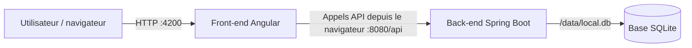

# Contexte

Jusqu'ici, vous avez utilisé des images construites par d'autres. Votre équipe vous confie maintenant une application à conteneuriser : un **back** Spring Boot (Java 21, base SQLite) et un **front** Angular, dans un même dépôt.

La démarche est celle d'un projet réel :

1. on part de la procédure d'installation que l'on taperait à la main sur un serveur ;
2. on la traduit telle quelle en `Dockerfile` : c'est la **V1, naïve** ;
3. on mesure le résultat (taille, couches, temps de build) ;
4. on optimise : c'est la **V2**.

**Prérequis :**

Clonez le dépôt de l'application de test [sample-app](https://github.com/jviallon63/sample-app). Il contient deux dossiers : `back/` (projet Maven) et `front/` (projet Angular). Le readme décrit comment executer chaque service. Vous n'avez besoin **ni de Java, ni de Maven, ni de Node.js** sur votre poste : tout se passe dans les images.



---

## Objectifs

<div class="section objective">

1. Traduire une procédure d'installation en `Dockerfile` en utilisant les instructions principales
2. Optimiser la taille d'une image et éviter d'y laisser des fichiers inutiles ou des secrets
3. Construire, versionner et étiqueter ses images

</div>

---

## Étape 1 - Du shell au Dockerfile : le back, V1

Voici la procédure qu'un administrateur suivrait pour installer le back sur un serveur **Ubuntu 24.04 vierge**, connecté en root :

```bash
## Installation pré-requis
apt-get update
apt-get install -y openjdk-21-jdk-headless maven

## Compilation
mkdir -p /app
cp -r . /app/
cd /app
mvn package -DskipTests

## Execution
mkdir -p /data
java -jar target/openapi-workshop-1.0.0.jar
```

L'application écoute sur le port `8080`, sous le chemin `/api`, et stocke sa base SQLite dans `/data/app.db`.

**Ce que vous devez faire :**

- Écrivez `back/Dockerfile` en traduisant la procédure **le plus directement possible**, une commande par instruction. L'image de base est `ubuntu:24.04`
- Construisez l'image avec le nom `tp3-back:v1` en utilisant `back/` comme contexte de build.
- Lancez un conteneur `back` en publiant le port 8080 et en utilisant un volume pour la base de données, puis testez avec <http://localhost:8080/api/swagger-ui.html>.

**Questions de réflexion :**

- Relevez la taille de l'image et affichez son historique. Identifiez les axes d'optimisation.


{::nomarkdown}
<details><summary>Solution - Étape 1</summary>
{:/nomarkdown}

`back/Dockerfile`, V1 :

```dockerfile
FROM ubuntu:24.04

RUN apt-get update
RUN apt-get install -y openjdk-21-jdk-headless maven

WORKDIR /app
COPY . .
RUN mvn package -DskipTests

RUN mkdir -p /data
CMD ["java", "-jar", "target/openapi-workshop-1.0.0.jar"]
```

```bash
docker build -t tp3-back:v1 back/
docker container run -d --name back -p 8080:8080 -v ./data/:/data/ tp3-back:v1
docker container logs -f back                 # attendre « Started OpenapiWorkshopApplication »
docker image ls tp3-back
docker image history tp3-back:v1
```

{::nomarkdown}
</details>
{:/nomarkdown}


---

## Étape 2 - Du shell au Dockerfile : le front, V1

Voici la procédure d'installation du front, sur une machine où **Node.js 22** est déjà installé (image officielle `node:22`) :

```bash
mkdir -p /app
cp -r <dossier front du dépôt>/. /app/
cd /app
npm install
npm install -g @angular/cli
ng build
npm install -g serve

export BACKEND_URL=http://localhost:8080
./docker-entrypoint.sh
```

Le script `docker-entrypoint.sh` écrit l'URL du back dans `/app/dist/browser/assets/config.js`, que le navigateur charge au démarrage de l'application, puis lance le serveur web `serve` sur le port 4200 avec `exec`.

**Ce que vous devez faire :**

- Écrivez `front/Dockerfile` en traduisant la procédure le plus directement possible.
- Construisez l'image `tp3-front:v1`, lancez un conteneur `front` en publiant le port 4200 et en définissant `BACKEND_URL`. Vérifiez que l'application s'affiche sur <http://localhost:4200> et qu'elle affiche les données du back.

**Questions de réflexion :**

- Relevez la taille de l'image et affichez son historique. Identifiez les axes d'optimisation.


{::nomarkdown}
<details><summary>Solution - Étape 2</summary>
{:/nomarkdown}

`front/Dockerfile`, V1 :

```dockerfile
FROM node:22

WORKDIR /app
COPY . .
RUN npm install
RUN npm install -g @angular/cli
RUN ng build
RUN npm install -g serve
RUN chmod +x /app/docker-entrypoint.sh

EXPOSE 4200
ENTRYPOINT ["/app/docker-entrypoint.sh"]
```

```bash
docker build -t tp3-front:v1 front/
docker container run -d --name front -p 4200:4200 -e BACKEND_URL=http://localhost:8080 tp3-front:v1
docker image ls tp3-front
docker image history tp3-front:v1
```

{::nomarkdown}
</details>
{:/nomarkdown}


---

## Étape 3 - Choisir son image de base

| Famille | Exemples | Taille | Débogage | Compatibilité |
| --- | --- | --- | --- | --- |
| Debian / Ubuntu | `ubuntu:24.04`, `debian:bookworm`, `eclipse-temurin:21-jdk` | La plus grosse | Shell, gestionnaire de paquets, outils courants | glibc : compatible avec quasiment tous les binaires Linux |
| `-slim` | `debian:bookworm-slim`, `node:22-slim` | Moyenne | Shell et `apt`, peu d'outils | glibc |
| Alpine | `alpine:3`, `node:22-alpine`, `eclipse-temurin:21-jdk-alpine` | Très petite | Shell `ash` (BusyBox), `apk` | **musl** au lieu de glibc : certains binaires précompilés ne fonctionnent pas, comportements parfois différents (DNS, performances) |
| Distroless | `gcr.io/distroless/java21-debian12` | Petite | **Aucun shell**, aucun gestionnaire de paquets | glibc |

**Ce que vous devez faire :**

- Téléchargez les images suivantes et comparez leurs tailles : `eclipse-temurin:21-jdk`, `eclipse-temurin:21-jdk-alpine`, `eclipse-temurin:21-ubi10-minimal`, `eclipse-temurin:21-jre-alpine`, `gcr.io/distroless/java21-debian12`.
- Affichez la liste des outils présents dans le JDK et dans le JRE alpine (`ls /opt/java/openjdk/bin`). Lequel contient `javac` ?


{::nomarkdown}
<details><summary>Solution - Étape 3</summary>
{:/nomarkdown}

```bash
docker image pull eclipse-temurin:21-jdk
docker image pull eclipse-temurin:21-jdk-alpine
docker image pull eclipse-temurin:21-ubi10-minimal
docker image pull eclipse-temurin:21-jre-alpine
docker image pull gcr.io/distroless/java21-debian12
docker images --format 'table {{.Repository}}:{{.Tag}}\t{{.Size}}' | grep -E 'temurin|distroless'
```

Le JRE est sensiblement plus petit que le JDK, et la variante alpine encore plus. Le JDK contient le compilateur `javac`, les outils de diagnostic (`jcmd`, `jmap`...) et `jlink` ; le JRE ne contient que de quoi **exécuter** du bytecode (`java`).

On ne peut pas compiler à partir du JRE (pas de `javac`), ni à partir de distroless (pas de shell pour exécuter `RUN`, pas de Maven). Avec un Dockerfile à une étape, l'image qui compile est aussi celle qui s'exécute : on est condamné au JDK. Le build multi-étapes permet de compiler dans une image JDK, puis de ne copier que le jar dans une image JRE ou distroless.

En production, on privilégie une image minimale : distroless ou JRE alpine, si la compatibilité musl est vérifiée. Pour déboguer, une image avec shell est plus pratique, ou un conteneur de débogage attaché temporairement au conteneur de production (`docker debug`, `kubectl debug`).

{::nomarkdown}
</details>
{:/nomarkdown}


---

## Étape 4 - Le back, V2 : optimiser les commandes et les couches

**Ce que vous devez faire :**

Repartez de votre V1 et appliquez les règles suivantes, puis construisez `tp3-back:v2` :

- Conservez l'image de base `ubuntu:24.04` pour avoir une bonne base de comparaison.
- regroupez les `RUN` et nettoyer `apt-get update` et `apt-get install`.
- ordonnez les instructions pour le cache.
- dans l'instruction qui compile, copiez le jar `target/openapi-workshop-*.jar` vers `/app/app.jar` et supprimez `target/`.
- créer un répertoire vide `/data`.
- créez un groupe système `app` et l'utilisateur système `app` dans ce groupe, puis faites tourner l'application avec lui.
- documentez le port avec `EXPOSE`.
- lancez Java avec `ENTRYPOINT`, et passez le port par défaut avec `CMD`. Hors docker la commande est `java -jar /app/app.jar --server.port=8080"`

**Questions de réflexion :**

- Comparez les tailles de V1 et V2, et leurs `docker image history`.
- **Expérience :** déplacez le `rm -rf /var/lib/apt/lists/*` dans un `RUN` séparé, reconstruisez, et comparez la taille.
- Pourquoi conserver `apy-get update` et `apt-get install` ?
- Pourquoi faire tourner l'application avec un utilisateur non root ?
- Lancez la V2 sur le port 9090 **sans modifier l'image**, en profitant de la combinaison `ENTRYPOINT` + `CMD`.


{::nomarkdown}
<details><summary>Solution - Étape 4</summary>
{:/nomarkdown}

`back/Dockerfile`, V2 :

```dockerfile
FROM ubuntu:24.04

RUN apt-get update \
 && apt-get install -y openjdk21-jdk-headless maven \
 && rm -rf /var/lib/apt/lists/*

RUN addgroup --system app && adduser --system --ingroup app app

WORKDIR /app

COPY pom.xml .
COPY src ./src
RUN mvn package -DskipTests \
 && cp target/openapi-workshop-*.jar /app/app.jar \
 && rm -rf target

RUN mkdir /data && chown app:app /data

USER app:app
EXPOSE 8080
ENTRYPOINT ["java", "-jar", "/app/app.jar"]
CMD ["--server.port=8080"]
```

```bash
docker build -t tp3-back:v2 back/
docker image ls tp3-back
docker image history tp3-back:v2
```

Une couche ne contient que les **différences** par rapport à la précédente. Un `RUN rm` séparé ajoute une couche qui marque les fichiers comme supprimés (des fichiers spéciaux appelés *whiteouts*), mais la couche précédente, qui les contient, est toujours téléchargée et stockée. Le nettoyage doit avoir lieu dans l'instruction qui crée les fichiers. C'est la raison d'être des longues chaînes de commandes reliées par `&&`.

Les gains de la V2 viennent des index `apt` supprimés, des paquets recommandés évités, du dossier `target/` supprimé et du code source réduit au strict nécessaire. Le cache est aussi bien plus efficace.

Lancement sur un autre port :

```bash
docker rm -f back
docker run -d --name back -p 8080:8080 tp3-back:v2 --server.port=9090
```

L'argument `--server.port=9090` remplace le `CMD` et est ajouté après l'`ENTRYPOINT`.

{::nomarkdown}
</details>
{:/nomarkdown}


---

## Étape 5 - Le front, V2

**Ce que vous devez faire :**

Repartez de votre V1 du front et construisez `tp3-front:v2` en appliquant :

- une image de base `node:22-alpine`.
- `npm ci` au lieu de `npm install`, et `npx ng build` au lieu d'une installation globale d'Angular CLI.
- le nettoyage du cache npm et du cache de build Angular (dossier `.angular`) dans les instructions qui les créent.
- l'ordre des instructions.
- l'utilisateur non root `node`, déjà présent dans l'image, avec `COPY --chown` pour lui donner les fichiers.
- une valeur par défaut pour `BACKEND_URL`.

Comparez ensuite les tailles et les historiques de V1 et V2.

**Questions de réflexion :**

- Comparez ensuite les tailles et les historiques de V1 et V2.
- Pourquoi `COPY --chown=node:node` plutôt que `COPY` suivi de `RUN chown -R node:node /app` ?


{::nomarkdown}
<details><summary>Solution - Étape 5</summary>
{:/nomarkdown}

`front/Dockerfile`, V2 :

```dockerfile
FROM node:22-alpine

RUN npm install -g serve && npm cache clean --force

WORKDIR /app
RUN chown node:node /app
USER node

COPY --chown=node:node . .
RUN npm ci && npm cache clean --force
RUN npx ng build && rm -rf .angular

ENV BACKEND_URL=http://localhost:8080
EXPOSE 4200
ENTRYPOINT ["/app/docker-entrypoint.sh"]
```

```bash
docker build -t tp3-front:v2 front/
docker image ls tp3-front
docker image history tp3-front:v2
```

Le passage à `alpine` et le nettoyage des caches réduisent nettement la taille. Mais `node_modules` (tout l'outillage de compilation Angular), Node.js lui-même et les sources restent dans l'image, alors que l'exécution n'a besoin que du dossier `dist/browser` et d'un serveur web. Supprimer `node_modules` dans une couche suivante ne servirait à rien (étape 6), et le supprimer dans la couche de `npm ci` casserait le build. Là encore, le build multi-étapes est la solution.

{::nomarkdown}
</details>
{:/nomarkdown}

