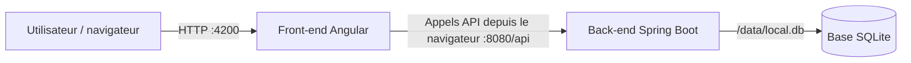



# Contexte

Jusqu'ici, vous avez utilisé des images construites par d'autres. Votre équipe vous confie maintenant une application à conteneuriser : un **back** Spring Boot (Java 17, base SQLite) et un **front** Angular, dans un même dépôt.

La démarche est celle d'un projet réel :

1. on part de la procédure d'installation que l'on taperait à la main sur un serveur ;
2. on la traduit telle quelle en `Dockerfile` : c'est la **V1, naïve** ;
3. on mesure le résultat (taille, couches, temps de build) ;
4. on optimise : c'est la **V2**.

**Prérequis :**

Clonez le dépôt de l'application de test [sample-app](https://github.com/jviallon63/sample-app). Il contient deux dossiers : `back/` (projet Maven) et `front/` (projet Angular). Le readme décrit comment executer chaque service. Vous n'avez besoin **ni de Java, ni de Maven, ni de Node.js** sur votre poste : tout se passe dans les images.



---

## Objectifs

<div class="section objective">

1. Traduire une procédure d'installation en `Dockerfile` en utilisant les instructions principales
2. Optimiser la taille d'une image et éviter d'y laisser des fichiers inutiles ou des secrets
3. Construire, versionner et étiqueter ses images

</div>

---

## Étape 1 - Du shell au Dockerfile : le back, V1

Voici la procédure qu'un administrateur suivrait pour installer le back sur un serveur **Ubuntu 24.04 vierge**, connecté en root :

```bash
## Installation pré-requis
apt-get update
apt-get install -y openjdk-17-jdk-headless maven

## Compilation
mkdir -p /app
cp -r . /app/
cd /app
mvn package -DskipTests

## Execution
mkdir -p /data
java -jar target/openapi-workshop-1.0.0.jar
```

L'application écoute sur le port `8080`, sous le chemin `/api`, et stocke sa base SQLite dans `/data/app.db`.

**Ce que vous devez faire :**

- Écrivez `back/Dockerfile` en traduisant la procédure **le plus directement possible**, une commande par instruction. L'image de base est `ubuntu:24.04`
- Construisez l'image avec le nom `tp3-back:v1` en utilisant `back/` comme contexte de build.
- Lancez un conteneur `back` en publiant le port 8080 et en utilisant un volume pour la base de données, puis testez avec <http://localhost:8080/api/swagger-ui.html>.

**Questions de réflexion :**

- Relevez la taille de l'image et affichez son historique. Identifiez les axes d'optimisation.

{::nomarkdown}
<details><summary>Solution - Étape 1</summary>
{:/nomarkdown}

`back/Dockerfile`, V1 :

```dockerfile
FROM ubuntu:24.04

RUN apt-get update
RUN apt-get install -y openjdk-17-jdk-headless maven

WORKDIR /app
COPY . .
RUN mvn package -DskipTests

RUN mkdir -p /data
CMD ["java", "-jar", "target/openapi-workshop-1.0.0.jar"]
```

```bash
docker build -t tp3-back:v1 back/
docker container run -d --name back -p 8080:8080 -v ./data/:/data/ tp3-back:v1
docker container logs -f back                 # attendre « Started OpenapiWorkshopApplication »
docker image ls tp3-back
docker image history tp3-back:v1
```

{::nomarkdown}
</details>
{:/nomarkdown}

---

## Étape 2 - Du shell au Dockerfile : le front, V1

Voici la procédure d'installation du front, sur une machine où **Node.js 22** est déjà installé (image officielle `node:22`) :

```bash
mkdir -p /app
cp -r <dossier front du dépôt>/. /app/
cd /app
npm install
npm install -g @angular/cli
ng build
npm install -g serve

export BACKEND_URL=http://localhost:8080
./docker-entrypoint.sh
```

Le script `docker-entrypoint.sh` écrit l'URL du back dans `/app/dist/browser/assets/config.js`, que le navigateur charge au démarrage de l'application, puis lance le serveur web `serve` sur le port 4200 avec `exec`.

**Ce que vous devez faire :**

- Écrivez `front/Dockerfile` en traduisant la procédure le plus directement possible.
- Construisez l'image `tp3-front:v1`, lancez un conteneur `front` en publiant le port 4200 et en définissant `BACKEND_URL`. Vérifiez que l'application s'affiche sur <http://localhost:4200> et qu'elle affiche les données du back.

**Questions de réflexion :**

- Relevez la taille de l'image et affichez son historique. Identifiez les axes d'optimisation.

{::nomarkdown}
<details><summary>Solution - Étape 2</summary>
{:/nomarkdown}

`front/Dockerfile`, V1 :

```dockerfile
FROM node:22

WORKDIR /app
COPY . .
RUN npm install
RUN npm install -g @angular/cli
RUN ng build
RUN npm install -g serve
RUN chmod +x /app/docker-entrypoint.sh

EXPOSE 4200
ENTRYPOINT ["/app/docker-entrypoint.sh"]
```

```bash
docker build -t tp3-front:v1 front/
docker container run -d --name front -p 4200:4200 -e BACKEND_URL=http://localhost:8080 tp3-front:v1
docker image ls tp3-front
docker image history tp3-front:v1
```

{::nomarkdown}
</details>
{:/nomarkdown}

---

## Étape 3 - Choisir son image de base

| Famille | Exemples | Taille | Débogage | Compatibilité |
| --- | --- | --- | --- | --- |
| Debian / Ubuntu | `ubuntu:24.04`, `debian:bookworm`, `eclipse-temurin:17-jdk` | La plus grosse | Shell, gestionnaire de paquets, outils courants | glibc : compatible avec quasiment tous les binaires Linux |
| `-slim` | `debian:bookworm-slim`, `node:22-slim` | Moyenne | Shell et `apt`, peu d'outils | glibc |
| Alpine | `alpine:3`, `node:22-alpine`, `eclipse-temurin:17-jdk-alpine` | Très petite | Shell `ash` (BusyBox), `apk` | **musl** au lieu de glibc : certains binaires précompilés ne fonctionnent pas, comportements parfois différents (DNS, performances) |
| Distroless | `gcr.io/distroless/java17-debian12` | Petite | **Aucun shell**, aucun gestionnaire de paquets | glibc |

**Ce que vous devez faire :**

- Téléchargez les images suivantes et comparez leurs tailles : `eclipse-temurin:21-jdk`, `eclipse-temurin:21-jdk-alpine`, `eclipse-temurin:21-ubi10-minimal`, `eclipse-temurin:21-jre-alpine`, `gcr.io/distroless/java21-debian12`.
- Affichez la liste des outils présents dans le JDK et dans le JRE alpine (`ls /opt/java/openjdk/bin`). Lequel contient `javac` ?

{::nomarkdown}
<details><summary>Solution - Étape 3</summary>
{:/nomarkdown}

```bash
docker image pull eclipse-temurin:21-jdk
docker image pull eclipse-temurin:21-jdk-alpine
docker image pull eclipse-temurin:21-ubi10-minimal
docker image pull eclipse-temurin:21-jre-alpine
docker image pull gcr.io/distroless/java21-debian12
docker images --format 'table {{.Repository}}:{{.Tag}}\t{{.Size}}' | grep -E 'temurin|distroless'
```

Le JRE est sensiblement plus petit que le JDK, et la variante alpine encore plus. Le JDK contient le compilateur `javac`, les outils de diagnostic (`jcmd`, `jmap`...) et `jlink` ; le JRE ne contient que de quoi **exécuter** du bytecode (`java`).

On ne peut pas compiler à partir du JRE (pas de `javac`), ni à partir de distroless (pas de shell pour exécuter `RUN`, pas de Maven). Avec un Dockerfile à une étape, l'image qui compile est aussi celle qui s'exécute : on est condamné au JDK. Le build multi-étapes permet de compiler dans une image JDK, puis de ne copier que le jar dans une image JRE ou distroless.

En production, on privilégie une image minimale : distroless ou JRE alpine, si la compatibilité musl est vérifiée. Pour déboguer, une image avec shell est plus pratique, ou un conteneur de débogage attaché temporairement au conteneur de production (`docker debug`, `kubectl debug`).

{::nomarkdown}
</details>
{:/nomarkdown}

---

## Étape 4 - Le back, V2 : optimiser les commandes et les couches

**Ce que vous devez faire :**

Repartez de votre V1 et appliquez les règles suivantes, puis construisez `tp3-back:v2` :

- Conservez l'image de base `ubuntu:24.04` pour avoir une bonne base de comparaison.
- regroupez les `RUN` et nettoyer `apt-get update` et `apt-get install`.
- ordonnez les instructions pour le cache.
- dans l'instruction qui compile, copiez le jar `target/openapi-workshop-*.jar` vers `/app/app.jar` et supprimez `target/`.
- créer un répertoire vide `/data`.
- créez un groupe système `app` et l'utilisateur système `app` dans ce groupe, puis faites tourner l'application avec lui.
- documentez le port avec `EXPOSE`.
- lancez Java avec `ENTRYPOINT`, et passez le port par défaut avec `CMD`. Hors docker la commande est `java -jar /app/app.jar --server.port=8080"`

**Questions de réflexion :**

- Comparez les tailles de V1 et V2, et leurs `docker image history`.
- **Expérience :** déplacez le `rm -rf /var/lib/apt/lists/*` dans un `RUN` séparé, reconstruisez, et comparez la taille.
- Pourquoi conserver `apy-get update` et `apt-get install` ?
- Pourquoi faire tourner l'application avec un utilisateur non root ?
- Lancez la V2 sur le port 9090 **sans modifier l'image**, en profitant de la combinaison `ENTRYPOINT` + `CMD`.

{::nomarkdown}
<details><summary>Solution - Étape 4</summary>
{:/nomarkdown}

`back/Dockerfile`, V2 :

```dockerfile
FROM ubuntu:24.04

RUN apt-get update \
 && apt-get install -y openjdk-17-jdk-headless maven \
 && rm -rf /var/lib/apt/lists/*

RUN addgroup --system app && adduser --system --ingroup app app

WORKDIR /app

COPY pom.xml .
COPY src ./src
RUN mvn package -DskipTests \
 && cp target/openapi-workshop-*.jar /app/app.jar \
 && rm -rf target

RUN mkdir /data && chown app:app /data

USER app:app
EXPOSE 8080
ENTRYPOINT ["java", "-jar", "/app/app.jar"]
CMD ["--server.port=8080"]
```

```bash
docker build -t tp3-back:v2 back/
docker image ls tp3-back
docker image history tp3-back:v2
```

Une couche ne contient que les **différences** par rapport à la précédente. Un `RUN rm` séparé ajoute une couche qui marque les fichiers comme supprimés (des fichiers spéciaux appelés *whiteouts*), mais la couche précédente, qui les contient, est toujours téléchargée et stockée. Le nettoyage doit avoir lieu dans l'instruction qui crée les fichiers. C'est la raison d'être des longues chaînes de commandes reliées par `&&`.

Les gains de la V2 viennent des index `apt` supprimés, des paquets recommandés évités, du dossier `target/` supprimé et du code source réduit au strict nécessaire. Le cache est aussi bien plus efficace.

Lancement sur un autre port :

```bash
docker rm -f back
docker run -d --name back -p 8080:8080 tp3-back:v2 --server.port=9090
```

L'argument `--server.port=9090` remplace le `CMD` et est ajouté après l'`ENTRYPOINT`.

{::nomarkdown}
</details>
{:/nomarkdown}

---

## Étape 5 - Le front, V2

**Ce que vous devez faire :**

Repartez de votre V1 du front et construisez `tp3-front:v2` en appliquant :

- une image de base `node:22-alpine`.
- `npm ci` au lieu de `npm install`, et `npx ng build` au lieu d'une installation globale d'Angular CLI.
- le nettoyage du cache npm et du cache de build Angular (dossier `.angular`) dans les instructions qui les créent.
- l'ordre des instructions.
- l'utilisateur non root `node`, déjà présent dans l'image, avec `COPY --chown` pour lui donner les fichiers.
- une valeur par défaut pour `BACKEND_URL`.

Comparez ensuite les tailles et les historiques de V1 et V2.

**Questions de réflexion :**

- Quelle différence entre `npm install` et `npm ci` ?
- Pourquoi `COPY --chown=node:node` plutôt que `COPY` suivi de `RUN chown -R node:node /app` ?
- Un `ARG` déclaré avant `FROM` est-il utilisable dans les instructions qui suivent `FROM` ?
- Que reste-t-il dans l'image qui ne sert pas à l'exécution ?

{::nomarkdown}
<details><summary>Solution - Étape 5</summary>
{:/nomarkdown}

`front/Dockerfile`, V2 :

```dockerfile
ARG NODE_VERSION=22
FROM node:${NODE_VERSION}-alpine

RUN npm install -g serve && npm cache clean --force

WORKDIR /app
RUN chown node:node /app
USER node

COPY --chown=node:node package.json package-lock.json ./
RUN npm ci && npm cache clean --force

COPY --chown=node:node . .
RUN npx ng build && rm -rf .angular

ENV BACKEND_URL=http://localhost:8080
EXPOSE 4200
ENTRYPOINT ["/app/docker-entrypoint.sh"]
```

```bash
docker build -t tp3-front:v2 front/
docker images tp3-front
docker history tp3-front:v2
```

`serve` est installé globalement **avant** `USER node`, car l'installation globale écrit dans `/usr/local`, réservé à root.

`npm install` résout les versions à partir des plages de `package.json` et peut mettre à jour `package-lock.json` : deux builds à une semaine d'intervalle peuvent produire des `node_modules` différents. `npm ci` installe **exactement** les versions de `package-lock.json`, échoue si les deux fichiers sont incohérents et repart d'un `node_modules` vide. C'est la commande des builds reproductibles.

`RUN chown -R` modifie les métadonnées de chaque fichier : il les **recopie tous** dans une nouvelle couche, ce qui peut doubler la taille d'un `node_modules`. `COPY --chown` attribue le propriétaire au moment de la copie, sans couche supplémentaire.

Un `ARG` déclaré avant `FROM` n'est visible que dans les lignes `FROM`. Pour l'utiliser plus loin, il faut le redéclarer (sans valeur) après `FROM` : `ARG NODE_VERSION`.

Le passage à `alpine` et le nettoyage des caches réduisent nettement la taille. Mais `node_modules` (tout l'outillage de compilation Angular), Node.js lui-même et les sources restent dans l'image, alors que l'exécution n'a besoin que du dossier `dist/browser` et d'un serveur web. Supprimer `node_modules` dans une couche suivante ne servirait à rien (étape 6), et le supprimer dans la couche de `npm ci` casserait le build. Là encore, le build multi-étapes est la solution.

{::nomarkdown}
</details>
{:/nomarkdown}

---

## Étape 8 - Options de build, tags et versions

Un nom d'image complet a la forme `registre/espace/nom:tag`, par exemple `ghcr.io/mon-equipe/tp3-back:1.0.0`. Sans registre, Docker Hub est utilisé ; sans tag, `latest`.

Le **versionnage sémantique** (`MAJEUR.MINEUR.CORRECTIF`) indique la nature des changements : `1.0.1` corrige un bug, `1.1.0` ajoute une fonctionnalité compatible, `2.0.0` casse la compatibilité.

**Ce que vous devez faire :**

- Construisez le back V2 en version `1.0.0`, en injectant cette version dans le `LABEL` avec `--build-arg`. Vérifiez le label avec `docker image inspect`.
- Ajoutez à la même image les tags `1.0`, `1` et `latest`. Listez les images : combien d'images distinctes avez-vous réellement ?
- Reconstruisez **sans utiliser le cache**, et comparez le temps de build avec un build avec cache.
- Construisez une version `1.0.1` après une petite modification du code. Vers quelle image pointent maintenant `1.0`, `1` et `latest` ? Que faut-il faire pour les mettre à jour ?

**Questions de réflexion :**

- Quel tag utiliser dans un fichier de déploiement de production ? Pourquoi pas `latest` ?
- Pourquoi ne faut-il jamais republier une image différente sous un tag déjà publié comme `1.0.0` ?

{::nomarkdown}
<details><summary>Solution - Étape 8</summary>
{:/nomarkdown}

```bash
docker build --build-arg APP_VERSION=1.0.0 -t tp3-back:1.0.0 back/
docker image inspect -f '{{index .Config.Labels "org.opencontainers.image.version"}}' tp3-back:1.0.0

docker tag tp3-back:1.0.0 tp3-back:1.0
docker tag tp3-back:1.0.0 tp3-back:1
docker tag tp3-back:1.0.0 tp3-back:latest
docker images tp3-back
```

Les quatre tags affichent le même `IMAGE ID` : un tag n'est qu'une étiquette qui pointe vers une image, et il n'y a qu'une image. On peut aussi poser plusieurs tags dès le build : `docker build -t tp3-back:1.0.0 -t tp3-back:1.0 ...`.

```bash
time docker build --no-cache --build-arg APP_VERSION=1.0.0 -t tp3-back:1.0.0 back/
```

`--no-cache` reconstruit toutes les étapes. On l'utilise pour forcer la récupération des dernières mises à jour de paquets (correctifs de sécurité) ou pour écarter un problème de cache. `--pull` force en plus le téléchargement de la dernière version de l'image de base.

Après le build de `1.0.1`, les tags `1.0`, `1` et `latest` pointent toujours vers `1.0.0` : un tag ne bouge jamais tout seul. Il faut les déplacer explicitement avec `docker tag tp3-back:1.0.1 tp3-back:1.0`, et ainsi de suite. C'est le travail du pipeline de CI à chaque publication.

En production, on déploie une version **immuable** (`1.0.1`), ou mieux, un digest. `latest` ne dit pas quelle version tourne, change sans prévenir au prochain `pull`, et rend un retour arrière impossible à garantir. Republier un tag déjà publié produit le même problème : deux serveurs qui ont téléchargé `1.0.0` à des moments différents exécutent des codes différents. Les registres d'entreprise interdisent souvent cette pratique (tags immuables).

> **Pour aller plus loin : `--target`.** Un Dockerfile peut contenir plusieurs `FROM`, chacun ouvrant une **étape** que l'on peut nommer (`FROM maven:3-eclipse-temurin-17 AS build`). `docker build --target build` s'arrête à l'étape indiquée. Cette option n'a de sens qu'avec un Dockerfile multi-étapes : ce sera l'objet du TP suivant.

{::nomarkdown}
</details>
{:/nomarkdown}

---

## Étape 9 - Tout lancer et faire le bilan

**Ce que vous devez faire :**

- Supprimez les conteneurs `back` et `front` existants.
- Lancez le back V2 avec un volume nommé `back-data` pour la base SQLite, puis le front V2 sur le port 4200.
- Dans l'application, créez quelques données. Supprimez le conteneur du back, relancez-le avec le même volume, et vérifiez que les données sont toujours là.
- Remplissez le tableau suivant avec `docker images` :

| Image | Taille |
| --- | --- |
| `tp3-back:v1` (Ubuntu + apt, naïve) | |
| `tp3-back:v2` (Ubuntu + apt, optimisée) | |
| back V2 sur `maven:3-eclipse-temurin-17` | |
| `eclipse-temurin:17-jre` seule (pour comparaison) | |
| `tp3-front:v1` (`node:22`, naïve) | |
| `tp3-front:v2` (`node:22-alpine`, optimisée) | |

- Faites le ménage : conteneurs, volume et images de ce TP.

**Question de réflexion :**

- Pour chaque image V2, estimez la part de la taille réellement nécessaire à l'exécution. Qu'est-ce qui vous empêche de supprimer le reste ?

{::nomarkdown}
<details><summary>Solution - Étape 9</summary>
{:/nomarkdown}

```bash
docker rm -f back front

docker run -d --name back -p 8080:8080 -v back-data:/data tp3-back:v2
docker run -d --name front -p 4200:4200 tp3-front:v2
```

`BACKEND_URL` a désormais une valeur par défaut dans l'image (`http://localhost:8080`) : inutile de la préciser.

```bash
docker rm -f back
docker run -d --name back -p 8080:8080 -v back-data:/data tp3-back:v2
```

Les données créées sont toujours présentes : la base SQLite vit dans le volume, pas dans le conteneur.

Ménage :

```bash
docker rm -f back front
docker volume rm back-data
docker rmi tp3-back:v1 tp3-back:v2 tp3-back:1.0.0 tp3-back:1.0.1 tp3-back:1.0 tp3-back:1 tp3-back:latest tp3-front:v1 tp3-front:v2
docker image prune
docker system df
```

Adaptez la liste des tags à ceux que vous avez réellement créés. Les images de base (`ubuntu`, `node`, `eclipse-temurin`...) peuvent être conservées pour le TP suivant.

Pour le back, seuls le jar (quelques dizaines de Mo) et un JRE sont nécessaires : le JDK, Maven, le dépôt `~/.m2` et les sources représentent la majorité de l'image. Pour le front, seul `dist/browser` (quelques Mo) et un serveur web sont nécessaires : Node.js, `node_modules` et les sources sont superflus. Avec une seule étape, tout ce qui sert à construire reste dans l'image qui s'exécute. Le TP suivant sépare les deux.

{::nomarkdown}
</details>
{:/nomarkdown}

---

## Récapitulatif des bonnes pratiques

| Pratique | Pourquoi |
| --- | --- |
| Ordonner les instructions du plus stable au plus changeant | Maximiser la réutilisation du cache |
| Copier les fichiers de dépendances avant le code | Ne pas retélécharger les dépendances à chaque modification du code |
| `apt-get update && apt-get install --no-install-recommends ... && rm -rf /var/lib/apt/lists/*` dans un seul `RUN` | Index à jour, pas de paquets superflus, pas d'index dans l'image |
| `apk add --no-cache`, `npm ci && npm cache clean --force` | Pas de cache de gestionnaire de paquets dans l'image |
| Nettoyer dans la même instruction que celle qui crée les fichiers | Une suppression dans une couche suivante ne réduit pas la taille |
| `.dockerignore` | Contexte léger, pas de fichiers locaux ni de données dans l'image |
| `COPY` plutôt que `ADD` | Pas d'extraction ni de téléchargement implicites |
| `COPY --chown` plutôt que `RUN chown -R` | Pas de duplication des fichiers dans une nouvelle couche |
| `ARG` pour le build, `ENV` pour l'exécution | Ne pas polluer l'environnement du conteneur |
| Aucun secret dans `ARG`, `ENV`, `COPY` ou dans le code | Tout ce qui est dans l'image est lisible par qui peut la télécharger |
| Forme *exec* pour `CMD` et `ENTRYPOINT`, `exec` dans les scripts | L'application reçoit les signaux d'arrêt |
| `USER` non root | Limiter l'impact d'une compromission |
| `LABEL` OCI | Traçabilité : version, source, description |
| Tags immuables et versionnage sémantique | Savoir ce qui tourne, pouvoir revenir en arrière |


